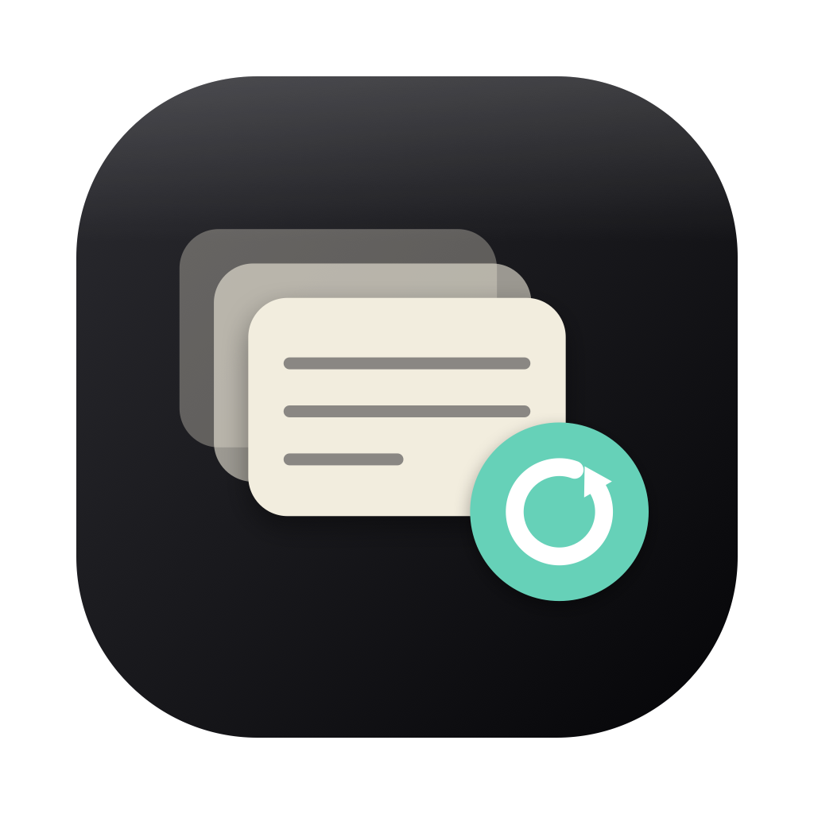
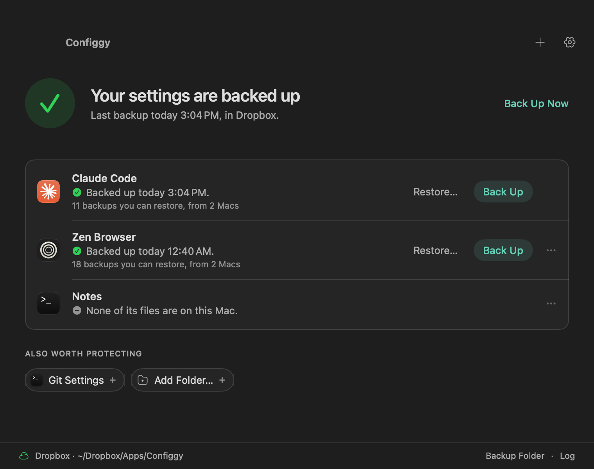
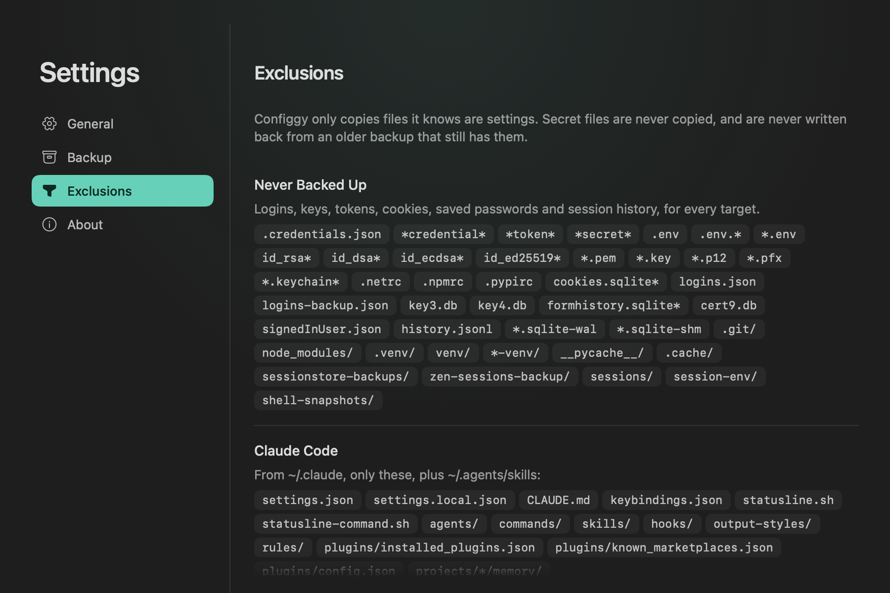
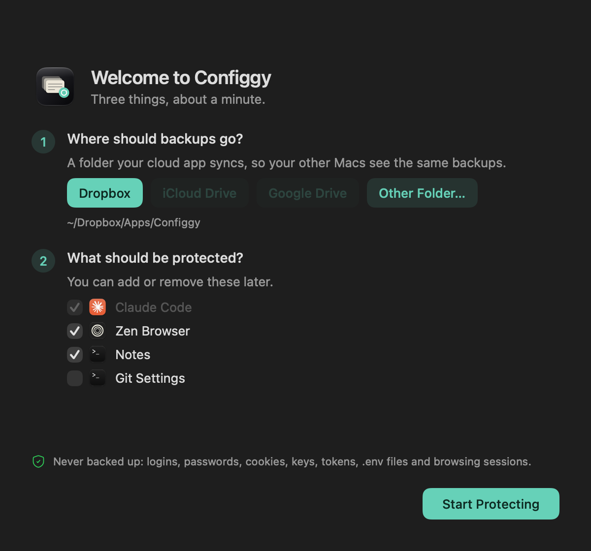

<p align="center">
  
</p>

<h1 align="center">Configgy</h1>

<p align="center">
  Backs up and restores your Mac's app settings — <b>Zen Browser</b>, <b>Claude Code</b>,
  and any folder you choose — to a cloud folder you already have. Never your logins or keys.
</p>

<p align="center"><a href="https://configgy.rocavence.com">configgy.rocavence.com</a> · <b>English</b> · <a href="README.zh-Hant.md">繁體中文</a></p>

<p align="center">
  
</p>

## Install

```sh
brew install --cask rocavence/tap/configgy
```

Or download `Configgy-x.y.z.zip` from [Releases](https://github.com/rocavence/Configgy-app/releases/latest), unzip it, and drag **Configgy** into Applications. It's self-signed (not notarized by Apple), so the first launch needs right-click → Open, or `xattr -dr com.apple.quarantine /Applications/Configgy.app`. Homebrew handles that for you.

The first launch walks you through three things: where backups go (Dropbox, iCloud Drive, Google Drive or any folder), Full Disk Access if that folder needs it, and what to protect. Requires macOS 14 or later.

## What it does

| Target | What's copied | When |
|---|---|---|
| **Zen Browser** | Preferences, `user.js`, themes, keyboard shortcuts, workspaces and tabs, containers, search engines, your CSS (`chrome/`) and installed extensions | Each time you quit Zen, if anything changed |
| **Claude Code** | `settings.json`, `CLAUDE.md`, `agents/`, `commands/`, `skills/`, `hooks/`, `output-styles/`, the plugin lists, each project's `memory/`, plus `~/.agents/skills` | When you click Back Up |
| **Folders** | The files and folders you pick, or ones Configgy suggests (shell, Git, SSH config, Zed, VS Code, terminals, Karabiner…) | When you click Back Up |

**Never backed up**, for every target: `.credentials.json`, anything named `*token*`, `*credential*` or `*secret*`, `.env` files, SSH and TLS keys (`id_*`, `*.pem`, `*.key`), `.netrc` / `.npmrc` / `.pypirc`, browser cookies, saved passwords (`logins.json`, `key4.db`), form history, certificates, session and history dumps, `.git/`, `node_modules/` and virtual environments. Old backups that still contain such files are found and can be cleaned. Restores never write them back either. The full lists are in Settings › Exclusions.

Each backup is a dated zip named after the Mac it came from. Configgy keeps 10 per target **per Mac** (adjustable) and never deletes another Mac's backups.

## Safety

- **Every step is checked.** A backup is zipped and tested locally first, then copied into the cloud folder under a temporary name and renamed. A missing or unwritable folder stops the backup with a clear message; nothing silently falls back to a local folder.
- **Restores preview first.** You see each file that will be replaced or added. The current versions are saved as a "before restore" copy, and that copy is checked before anything is written.
- **Restores stay in bounds.** A folder target only writes inside its own paths, stored relative to your home folder, so a backup from a Mac with another user name lands in the right place.
- **Zen is never closed without asking.** When Zen has to quit, Configgy asks, waits, and stops if Zen doesn't close.
- **Everything is logged** to `~/Library/Logs/Configgy/configgy.log`.

<table>
  <tr>
    <td width="50%"></td>
    <td width="50%"></td>
  </tr>
</table>

## Command line

The same app runs from Terminal:

```
Configgy backup | list | preview <zip> | restore <zip> [ws <uuid…>] | workspaces <zip>   # Zen
Configgy claude-backup | claude-list | claude-preview <zip> | claude-restore [zip]
Configgy targets | discover | target-add <id> <name> <path…>
Configgy target-backup | target-list | target-preview | target-restore <id> [zip]
Configgy locations | status | scan
```

`scan` lists backups that still contain secret files.

## Build from source

```sh
brew install xcodegen
./scripts/build-app.sh --install      # builds dist/Configgy-<version>.zip and installs it
```

Put your signing identity in `Config/Signing.local.xcconfig` (`CODE_SIGN_IDENTITY = …`); with a stable identity, Full Disk Access survives rebuilds.

```sh
xcodebuild test -project Configgy.xcodeproj -scheme Configgy   # unit tests
./scripts/selftest.sh [item]                                    # end-to-end, in a fake home and cloud folder
```

```
Configgy/
├── App/          AppModel (state and actions), menu-bar entry, settings, update check, self-test
├── CLI/          command line
├── Core/         backup and restore flow, snapshot store, secret filter, backup location, log
├── Targets/      Zen, Claude Code, folders, mozLz4
├── Window/       main window and restore sheet
├── Settings/     the settings card
├── Onboarding/   first-run guide
└── DesignSystem/ type, spacing, colours, accent, Reicon icons
scripts/          build-app.sh, selftest.sh, update-cask.py, icon/, reicon/, l10n/
```

## Design notes

Configgy began as **Zennly**, a menu-bar app that zipped the Zen profile to Dropbox on quit. Claude Code joined as a second target, and the idea generalised: a target is a set of paths, versioned as dated zips, with a preview and an additive restore.

Version 1.0 is a rebuild after an audit found it was backing up more than it promised. Claude backups had picked up the Claude Code login, and Zen backups held session dumps. So every target now copies an explicit allowlist instead of "everything except", one filter blocks secrets everywhere, and existing backups are scanned. The rest of 1.0 followed from the same question, "can this lose or leak something?": checked commands, verify-then-move, per-Mac retention, before-restore copies, scoped writes, and bounds-checked decoders. It shares its settings card, design system, six languages and update check with [Flione](https://flione.rocavence.com), Wunder and [Gamely](https://gamely.rocavence.com).

<sub>Licensed under <a href="LICENSE">CC BY-NC-SA 4.0</a> · a personal tool, shared as-is, with no warranty · built with Claude Code.</sub>
