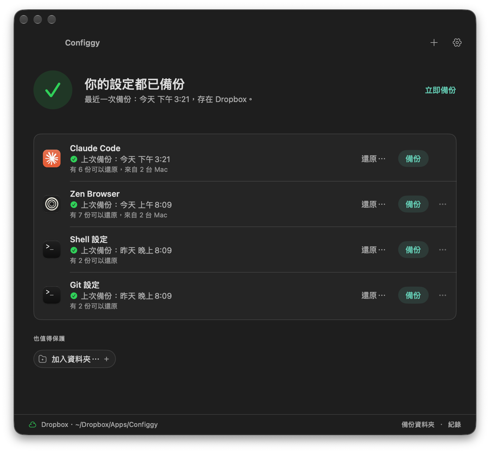
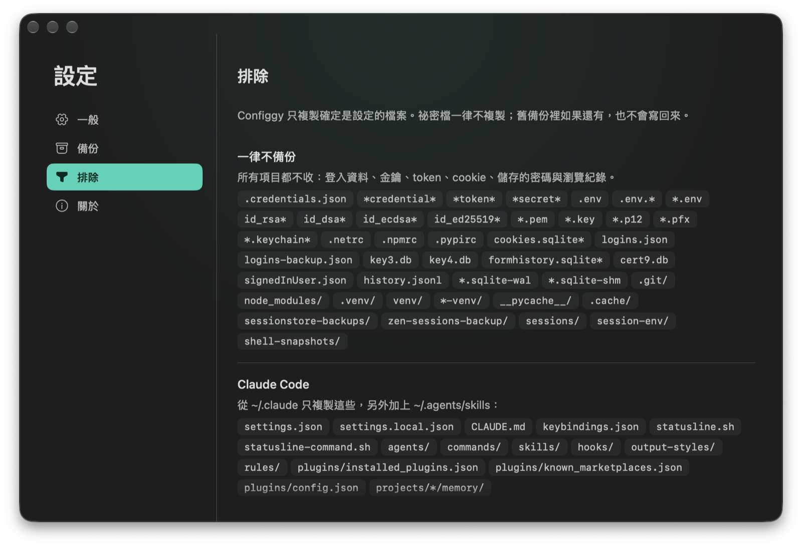
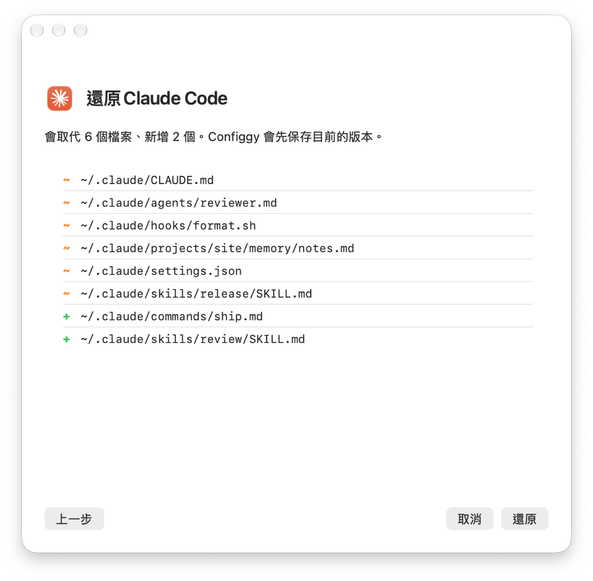

<p align="center">
  
</p>

<h1 align="center">Configgy</h1>

<p align="center">
  把 Mac 上的 App 設定（<b>Zen 瀏覽器</b>、<b>Claude Code</b>，以及你指定的資料夾）
  備份到你已經在用的雲端資料夾，也能還原到任何一台 Mac。登入資料與金鑰一律不備份。
</p>

<p align="center"><a href="https://configgy.rocavence.com">configgy.rocavence.com</a> · <a href="README.md">English</a> · <b>繁體中文</b></p>

<p align="center">
  
</p>

## 安裝

```sh
brew install --cask rocavence/tap/configgy
```

也可以到 [Releases](https://github.com/rocavence/Configgy-app/releases/latest) 下載 `Configgy-x.y.z.zip`，解壓縮後把 **Configgy** 拖進「應用程式」。這是自簽的 App（沒有經過 Apple 公證），第一次開啟要按右鍵 → 打開，或執行 `xattr -dr com.apple.quarantine /Applications/Configgy.app`。用 Homebrew 安裝會自動處理這一步。

第一次開啟會帶你完成三件事：備份要存在哪裡（Dropbox、iCloud Drive、Google Drive 或任何資料夾）、需要時授予完整磁碟取用權，以及要保護哪些設定。需要 macOS 14 以上。

## 它做什麼

| 項目 | 複製的內容 | 時機 |
|---|---|---|
| **Zen 瀏覽器** | 偏好設定、`user.js`、主題、快速鍵、工作區與分頁、容器、搜尋引擎、你的 CSS（`chrome/`）與已安裝的擴充功能 | 每次結束 Zen，有變動就備份 |
| **Claude Code** | `settings.json`、`CLAUDE.md`、`agents/`、`commands/`、`skills/`、`hooks/`、`output-styles/`、外掛清單、各專案的 `memory/`，以及 `~/.agents/skills` | 按「備份」時 |
| **資料夾** | 你挑的檔案與資料夾，或 Configgy 建議的項目（Shell、Git、SSH 設定、Zed、VS Code、終端機、Karabiner 等） | 按「備份」時 |

**一律不備份**（所有項目都適用）：`.credentials.json`、名稱含 `token`、`credential`、`secret` 的檔案、`.env` 檔、SSH 與 TLS 金鑰（`id_*`、`*.pem`、`*.key`）、`.netrc`／`.npmrc`／`.pypirc`、瀏覽器 cookie、儲存的密碼（`logins.json`、`key4.db`）、表單紀錄、憑證、工作階段與歷史紀錄、`.git/`、`node_modules/` 與虛擬環境。舊備份裡如果還有這類檔案，Configgy 會找出來讓你清除，還原時也不會寫回去。完整清單在「設定 › 排除」。

每份備份是一個標有日期、以來源 Mac 命名的 zip。每個項目、**每台 Mac** 各保留 10 份（可調整），不會刪到其他 Mac 的備份。

## 安全

- **每一步都會檢查**：備份先在本機打包並驗證，再用暫時的檔名複製進雲端資料夾，最後才改名。資料夾不見或無法寫入時會停下來並清楚告訴你，不會偷偷改存到本機。
- **還原前先預覽**：列出每個會被取代或新增的檔案。目前的版本會先另存一份「還原前」副本，並確認存好了才開始寫入。
- **還原不越界**：資料夾項目只會寫回它自己的路徑，路徑以家目錄為基準保存，使用者名稱不同的 Mac 也會放到對的地方。
- **不會擅自關閉 Zen**：需要結束 Zen 時一定先問你、等它關閉；關不掉就停止。
- **全部寫進紀錄**：`~/Library/Logs/Configgy/configgy.log`。

<table>
  <tr>
    <td width="50%"></td>
    <td width="50%"></td>
  </tr>
</table>

## 命令列

同一個 App 也能在終端機使用：

```
Configgy backup | list | preview <zip> | restore <zip> [ws <uuid…>] | workspaces <zip>   # Zen
Configgy claude-backup | claude-list | claude-preview <zip> | claude-restore [zip]
Configgy targets | discover | target-add <id> <name> <path…>
Configgy target-backup | target-list | target-preview | target-restore <id> [zip]
Configgy locations | status | scan
```

`scan` 會列出還含有祕密檔的備份。

## 從原始碼建置

```sh
brew install xcodegen
./scripts/build-app.sh --install      # 打包 dist/Configgy-<版本>.zip 並裝到「應用程式」
```

簽章身分放在 `Config/Signing.local.xcconfig`（`CODE_SIGN_IDENTITY = …`）。用固定的身分，重建後完整磁碟取用權才不會失效。

```sh
xcodebuild test -project Configgy.xcodeproj -scheme Configgy   # 單元測試
./scripts/selftest.sh [項目]                                     # 端對端自我測試，在假的家目錄與雲端資料夾執行
```

```
Configgy/
├── App/          AppModel（狀態與動作）、選單列進入點、設定、更新檢查、自我測試
├── CLI/          命令列
├── Core/         備份與還原流程、快照儲存、祕密過濾、備份位置、紀錄
├── Targets/      Zen、Claude Code、資料夾、mozLz4
├── Window/       主視窗與還原面板
├── Settings/     設定卡
├── Onboarding/   第一次使用導覽
└── DesignSystem/ 字級、間距、顏色、重點色、Reicon 圖示
scripts/          build-app.sh、selftest.sh、update-cask.py、icon/、reicon/、l10n/
```

## 設計筆記

Configgy 的前身是 **Zennly**：一個在結束 Zen 時把設定檔打包到 Dropbox 的選單列 App。後來加入 Claude Code，概念也一般化成「一組路徑，分版本存成有日期的 zip，可預覽、增量還原」。

1.0 是一次盤點後的重寫：我們發現它備份的東西比承諾的多，Claude 備份帶到了 Claude Code 的登入資料，Zen 備份也含有工作階段紀錄。所以現在每個項目都改成明確的允許清單，不再是「全部，除了某些」；同一套過濾規則擋下所有祕密，並掃描既有的備份。1.0 其他的改動也都來自同一個問題：「這會不會弄丟或外洩東西？」包括檢查每個指令的結果、先驗證再搬進雲端、每台 Mac 各自保留、還原前存副本、限制寫入範圍，以及有邊界檢查的解碼器。設定卡、設計規範、六種語言與更新檢查，都和 [Flione](https://flione.rocavence.com)、Wunder、[Gamely](https://gamely.rocavence.com) 共用。

<sub>以 <a href="LICENSE">CC BY-NC-SA 4.0</a> 授權 · 個人工具，原樣分享，不提供任何保證 · 用 Claude Code 打造。</sub>
